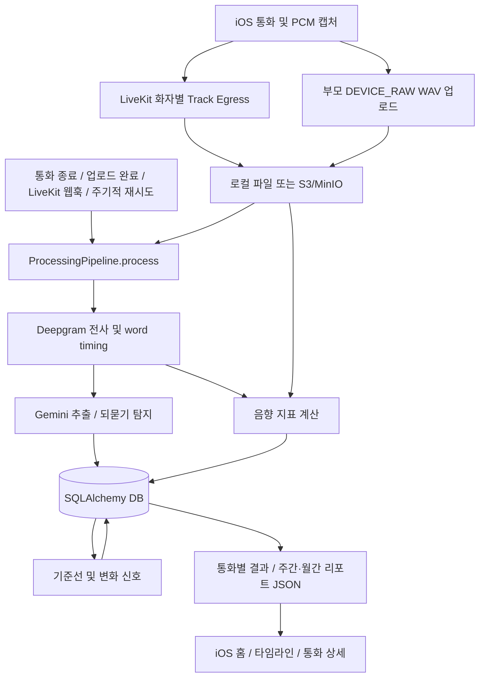

# 데이터 입출력과 분석 작업 시작점

확인 기준: `feat/data-analysis`, 기반 커밋 `d6f516e`. 현재 소스 기준으로 정리했으며 운영 DB나 실제 음성은 조회하지 않았다.

각 피처의 실제 계산식·임계값·예외는 [현재 피처 추출 방식](feature-extraction-current.md)에 정리했다.

## 1. 먼저 볼 파일

| 작업 목적 | 시작점 | 역할 |
|---|---|---|
| 서버 기동 | [main.py](../app/main.py) `create_app()` | FastAPI 생성, DB 스키마 확인, 백그라운드 유지보수 등록 |
| 서비스 연결 | [container.py](../app/container.py) `AppContainer` | DB·스토리지·STT·추출·음향·파이프라인 의존성 구성 |
| API 목록 | [api.py](../app/api.py) | 라우터 연결. 기본 prefix는 `/v1` |
| 분석 실행 | [pipeline.py](../app/services/pipeline.py) `ProcessingPipeline.process()` | 입력 준비 확인, 분석, 결과 저장, 원본 폐기 |
| 데이터 구조 | [models.py](../app/models.py), [schemas.py](../app/schemas.py) | DB 모델 및 요청/분석 스키마 |
| 전사·텍스트 분석 | [deepgram.py](../app/services/deepgram.py), [gemini.py](../app/services/gemini.py), [repeat_detector.py](../app/services/repeat_detector.py) | STT, 건강 대화 추출, 되묻기 탐지 |
| 음향 계산 | [acoustics.py](../app/services/acoustics.py) | 음향 지표와 측정 불가 사유 계산 |
| 기준선·변화 판단 | [signals.py](../app/services/signals.py) `rebuild_baselines()`, `process_call()` | 앵커/롤링 기준선, MAD 기반 비교, 변화 신호 |
| 화면용 기간 집계 | [reports.py](../app/services/reports.py) `ReportService.get_or_issue()` | 주간/월간 JSON 스냅샷 생성 및 재사용 |

## 2. 데이터 흐름



### 입력

- 통화 제어: `POST /v1/calls`, `/{callId}/accept`, `/{callId}/end` ([calls.py](../app/routes/calls.py)).
- 부모 분석용 오디오: `POST /v1/calls/{callId}/raw-audio/upload-url`에 메타데이터를 보내 `uploadUrl`, `assetId`를 받는다. 해당 URL로 파일을 PUT한 뒤 `POST /v1/calls/{callId}/raw-audio/complete`로 완료를 알린다 ([call_audio.py](../app/routes/call_audio.py)). iOS의 [AnalysisPCMWriter.swift](../../ios/Collog/AnalysisPCMWriter.swift)와 [VoipCallCenter.swift](../../ios/Collog/VoipCallCenter.swift)가 캡처·통화 흐름의 출발점이다.
- LiveKit 녹음: 부모/자녀 Track Egress 음성 및 서명 검증된 `POST /v1/webhooks/livekit` 이벤트 ([webhooks.py](../app/routes/webhooks.py)).
- 일반 메타데이터는 JSON, 실제 오디오는 바이너리 파일이다. CSV를 업로드해 분석 DB에 넣는 API는 현재 없다.

### 실행 조건과 처리

`process(call_id)`는 종료·동의·녹음 허용·업로드 준비·재시도 상태 등을 확인하므로, 호출만 했다고 즉시 분석이 완료되는 것은 아니다. 통화 종료, raw 업로드 완료, LiveKit 웹훅이 실행을 요청하고, 서버 유지보수 루프의 `process_pending()`이 미완료 처리를 재시도한다.

1. 부모/자녀 음성을 전사해 `speaker`, `segmentId`, `startMs`, `endMs`, `text`, `words`를 가진 segment 배열로 합친다.
2. 되묻기 이벤트를 탐지한다. 부모 발화가 기본 20초 미만이면 전사에 제외 사유를 남기고 후속 분석을 제외한다.
3. Gemini가 부모 발화 근거로 `symptom`, `medication`, `activity`, `sleep`과 `facts`를 추출한다. 추출 실패는 `parseStatus=FAILED`로 저장되므로 통화의 `ANALYZED`만 보고 추출 성공을 가정하지 않는다.
4. 음향 분석은 부모 raw 파일을 우선하고, 없으면 부모 녹음 소스를 사용한다. 입력 품질에 따라 값 대신 `UNMEASURABLE`과 사유가 저장될 수 있다.
5. 음향 지표와 기준선·변화 신호를 DB에 저장한다. 리포트는 별도 `get_or_issue()` 호출 시 조회하거나 발행한다.
6. 처리 완료/제외 시 원본을 폐기한다. 실패·재시도 파일에도 24시간 보관 제한과 정리 경로가 있다. 저장된 DB 결과가 있어도 원본 음성이 남아 있다고 가정하면 안 된다.

Egress 없이 raw WAV만 사용하는 경로는 `ALLOW_RAW_ONLY_ANALYSIS` 설정과 관련된다. [replay_call.py](../scripts/replay_call.py)는 `--raw-audio`만 지정하면 해당 실행에서 raw-only를 켠다.

## 3. 저장 구조와 CSV의 행 단위

DB 연결은 [config.py](../app/config.py)의 `database_url`, 파일 저장은 [storage.py](../app/services/storage.py)가 담당한다. 기본 DB는 `sqlite+aiosqlite:///./.data/collog.db`, 로컬 음성은 `.data/audio`이며 경로는 실행 디렉터리 기준이다. 배포는 PostgreSQL과 S3 구성을 사용한다.

| 테이블 | 내용 | 분석용으로 펼칠 단위 |
|---|---|---|
| `calls` | 부모/자녀 ID, 시각, 상태, 발화 길이, 처리 상태 | 통화 1건 |
| `audio_assets` | 파일 URI, 종류, 업로드·폐기 상태 | 파일 1건. 음성 자체는 DB 밖에 저장 |
| `transcripts` | `segments` JSON, 제외 여부/사유 | 통화 × segment. words는 별도 표로 분리 |
| `repeat_events` | 되묻기 구간, 규칙, 신뢰도 | 이벤트 1건 |
| `health_extractions` | 건강 대화 네 항목, 파싱 상태 | 통화 1건 |
| `extraction_evidence` | `facts` JSON과 스키마 버전 | 통화 × fact |
| `acoustic_features` | 지표, 값, 단위, 상태, 측정 불가 사유, 관측 시각 | 통화 × 지표 |
| `acoustic_analysis_runs` | 분석기/기침 탐지기 버전 | 통화 1건. `call_id`로 지표와 결합 |
| `baselines` | 기준선 종류, 시간대, 표본 수, median/MAD | 부모 × 지표 × 시간대 × 종류 |
| `change_signals` | 앵커/롤링 비교 JSON, 변화 신호 | 변화 신호 1건 |
| `reports` | 기간별 화면용 `snapshot` JSON | 리포트 1건. trends/items는 별도 표로 분리 |

음향 지표 키는 `COUGH_EVENTS`, `SPEECH_RATE`, `PAUSE_RATIO`, `F0_VARIATION`이다. 측정 불가 값을 0으로 바꾸면 실제 0과 구분되지 않으므로 `value`, `status`, `unmeasurable_reason`을 함께 내보낸다.

## 4. 출력 API와 화면 진입점

아래 API는 인증과 해당 통화/부모에 대한 접근 권한 검사를 거친다.

| GET 경로 | 주요 출력 |
|---|---|
| `/v1/parents/{parentId}/calls` | 통화 목록 |
| `/v1/calls/{callId}/transcript` | segments, 제외 사유, 부모 발화 길이, 되묻기 이벤트/횟수 |
| `/v1/calls/{callId}/extraction` | parseStatus, 네 추출 항목, facts, schemaVersion |
| `/v1/calls/{callId}/acoustic-features` | audioSource, 분석기 버전, features 배열 |
| `/v1/parents/{parentId}/baseline` | baselines 배열. 조회 중 기준선을 재계산하고 commit함 |
| `/v1/parents/{parentId}/signals` | signals 배열. ALL/PROMOTED/ACUTE 필터 |
| `/v1/parents/{parentId}/reports?period=WEEKLY` | conversationItems, acousticTrends, 변화 신호, 분석 통화 수 등 |

리포트는 `MONTHLY`와 `date=YYYY-MM-DD`도 지원한다. 기간 경계는 Asia/Seoul 기준으로 잡고 DB 조회 경계는 UTC로 변환한다. 기존 스냅샷을 재사용하는 조건이 있으므로 분석 로직을 수정했다고 과거 리포트가 자동으로 다시 계산되지는 않는다. GET 요청이라도 리포트 발행은 DB 쓰기를 발생시킬 수 있다.

화면 표시를 바꿀 때는 다음 순서로 보면 된다.

1. [CollogAPI.swift](../../ios/Collog/CollogAPI.swift): 응답 모델과 서버 호출. 서버 응답 필드 변경 시 함께 확인한다.
2. [HomeDashboardModel.swift](../../ios/Collog/HomeDashboardModel.swift) `reload()`: 주간 리포트, 질문, 통화, 기준선 조회. `primaryTrend`는 점이 2개 이상인 첫 지표를 고르고, 기준선은 같은 지표의 READY ANCHOR 중 표본이 가장 많은 것을 고른다.
3. [HomeDashboardView.swift](../../ios/Collog/HomeDashboardView.swift): 홈 카드/그래프 표시.
4. [TimelineView.swift](../../ios/Collog/TimelineView.swift): 통화 기록 표시.
5. [CallResultView.swift](../../ios/Collog/CallResultView.swift): 통화별 추출·음향·전사 조회 및 표시.

그래프에 보이는 리포트 `acousticTrends`는 `status=OK`인 값만 포함하며 점에는 날짜와 값만 있다. 실패율, 통화 ID, 정밀 시각, 버전까지 분석하려면 통화별 API나 DB 테이블을 사용한다.

## 5. pandas / CSV 지원 확인

- 현재 `pyproject.toml` 및 `uv.lock`에 pandas가 없고, 앱/스크립트에 pandas 사용이나 CSV import/export 구현도 없다.
- 현재 API 출력과 `replay_call.py`, `acoustic_quality_report.py` 등의 출력은 JSON이다. replay는 경고 등도 stdout에 출력할 수 있어 출력을 그대로 순수 JSON 파일로 간주하면 안 된다.
- **변환은 가능하다.** JSON 배열을 pandas 표로 펼친 후 CSV로 저장할 수 있다. 단순 CSV 출력은 Python 표준 `csv`로도 구현할 수 있다.
- CSV를 다시 읽어 DataFrame으로 분석하는 것과 서비스 DB에 재입력하는 것은 별개다. 서비스 재입력은 현재 지원하지 않으며 검증·중복 처리·재계산 정책이 필요하다.

공식 API: [json_normalize](https://pandas.pydata.org/docs/reference/api/pandas.json_normalize.html)는 JSON을 표로 펼치고, [DataFrame.to_csv](https://pandas.pydata.org/docs/reference/api/pandas.DataFrame.to_csv.html)는 CSV를 출력한다.

### 복사해서 실행할 수 있는 더미 데이터 변환

아래는 음향 API 응답 형태의 더미 데이터를 사용한다. 서버나 DB에 연결하지 않으며 프로젝트 의존성 파일도 변경하지 않는다. 새 worktree의 `backend`에서 실행한다.

```bash
uv run --no-project --with pandas python - <<'PY'
from pathlib import Path
import pandas as pd

payload = {
    "callId": "demo-call",
    "audioSource": "DEVICE_RAW",
    "analyzerVersion": "demo-v1",
    "coughDetectorVersion": "demo-detector",
    "features": [
        {"metric": "SPEECH_RATE", "value": 2.5, "unit": "음절/분",
         "status": "OK", "unmeasurableReason": None},
        {"metric": "COUGH_EVENTS", "value": None, "unit": "구간",
         "status": "UNMEASURABLE", "unmeasurableReason": "MODEL_UNAVAILABLE"},
    ],
}
frame = pd.json_normalize(
    payload, record_path="features",
    meta=["callId", "audioSource", "analyzerVersion", "coughDetectorVersion"],
)
out = Path(".data/exports/acoustic-demo.csv")
out.parent.mkdir(parents=True, exist_ok=True)
frame.to_csv(out, index=False, encoding="utf-8-sig")
restored = pd.read_csv(out, encoding="utf-8-sig")
assert len(restored) == 2
assert pd.isna(restored.loc[1, "value"])
assert restored.loc[1, "status"] == "UNMEASURABLE"
print(f"CSV round-trip OK: {out}, {len(restored)} rows")
PY
```

실제 JSON 응답으로 바꿀 때는 동일한 형태의 응답을 `payload`에 넣으면 된다. 전사의 `segments`/`words`, 추출의 `facts` 등 중첩 배열은 각각 행 단위를 정해 별도 CSV로 분리한다. 여러 통화·지표·이벤트를 한 번에 join하면 행이 중복될 수 있으므로 `call_id`와 각 표의 행 단위를 먼저 정한다.

## 6. 분석 작업 환경과 기존 도구

새 worktree에는 기존 폴더의 ignored `.env`, `.data`, `.venv`, 모델 가중치가 자동 복사되지 않는다. `DATABASE_URL`과 스토리지 경로를 분석용으로 따로 설정해야 하며, 같은 원격 DB 주소를 넣으면 두 브랜치가 같은 데이터를 변경한다. 서버 기동 시 `schema_auto_reset` 설정에 따라 DB가 재생성될 수 있으므로 기존 데이터 조사에는 서버 기동 대신 복사본의 읽기 전용 조회가 적합하다.

| 도구 | 용도와 실행 영향 |
|---|---|
| [replay_call.py](../scripts/replay_call.py) | WAV/OGG로 파이프라인 재실행. 기존 계정/스키마가 필요하고 DB 및 스토리지에 쓰기 발생. mock 여부에 따라 외부 provider 호출 |
| [seed_narrative_history.py](../scripts/seed_narrative_history.py) | 준비된 서술형 이력으로 개발 데이터 생성. DB 쓰기 발생 |
| [evaluate_extraction.py](../scripts/evaluate_extraction.py) | 고정 fixture로 추출 평가. `--provider mock` 또는 `gemini`, JSON 요약 |
| [acoustic_quality_report.py](../scripts/acoustic_quality_report.py) | 저장된 지표의 성공률/실패 사유 JSON 집계 |

현재 `acoustic_quality_report.py --analyzer-version`은 `AcousticFeature.analyzer_version`을 참조하지만 해당 필드는 `AcousticAnalysisRun`에 있다. 지표가 있는 상태에서 필터를 사용하면 속성 오류가 발생할 수 있는 코드 불일치이며, 버전별 분석 전에 `call_id` join으로 수정해야 한다. 이번 문서화에서는 실행 로직을 변경하지 않았다.

이번 확인 범위는 소스 조사와 위 더미 JSON → CSV → 재읽기 검증이다. 운영 데이터 export, 실제 통화 분석, CSV 다운로드 API 추가는 포함하지 않는다.
