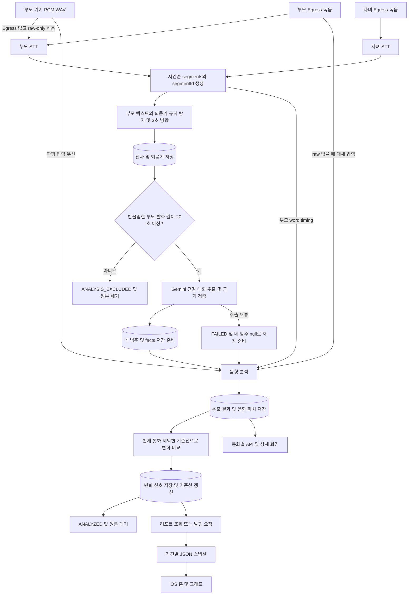
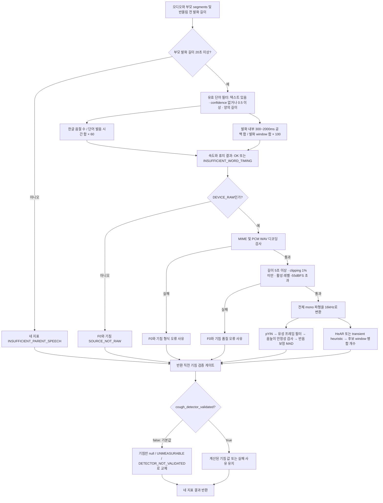
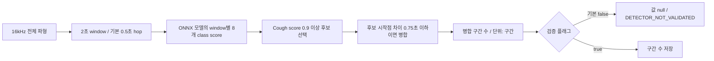
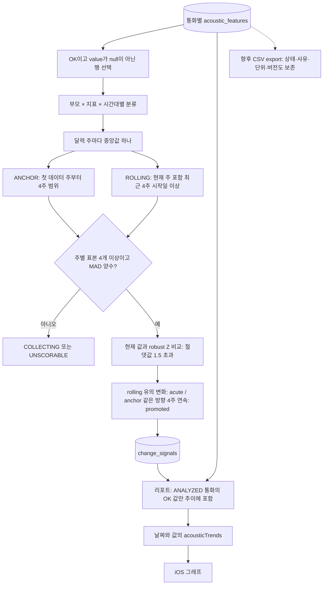

# 현재 피처 추출 방식 — 코드 기준

기준: `feat/data-analysis`의 기반 커밋 `d6f516e`. 아래 기본값은 `Settings` 선언 기준이며 실행 환경의 `.env`로 달라질 수 있다. 실제 배포 설정·운영 데이터·모델 정확도는 이번 작업에서 검증하지 않았다.

이 문서는 설계 의도가 아니라 현재 계산 코드를 설명한다. 주요 구현은 [acoustics.py](../app/services/acoustics.py), [pipeline.py](../app/services/pipeline.py), [deepgram.py](../app/services/deepgram.py), [config.py](../app/config.py)이다. 전체 API/화면 연결은 [데이터 분석 진입점](data-analysis-entrypoints.md)을 참고한다.

단계별 문제·미활용 정보와 개선 우선순위는 [파이프라인 분리 점검](pipeline-audit.md)을 참고한다.

## 다이어그램: 전체 피처 추출 흐름



이 그림은 업로드·동의·통화 종료 등 처리 진입 조건을 통과한 뒤의 계산 흐름이다. Gemini 오류만으로 음향 분석을 중단하지 않는다. 리포트는 분석 함수에서 즉시 만드는 것이 아니라 별도 조회·발행 경로에서 생성한다.

## 다이어그램: 음향 네 지표의 계산 분기



F0와 기침은 전체 WAV를 사용하며 STT 발화 구간으로 파형을 자르지 않는다. 그림의 F0·기침 가지는 입력 의존성을 나타내며 실제 병렬 실행을 뜻하지 않는다. 타이밍 지표는 파형 품질 실패와 독립적으로 유지된다. 기침 검증 게이트는 정상 반환 결과에 적용되며 예기치 않은 실행 예외를 흡수하는 장치는 아니다.

## 다이어그램: 기본 HeAR 기침 검출



이 그림은 모델 로딩과 파형 품질 검사를 통과한 경우다. 병합 기준은 2초 window의 겹침 여부가 아니라 후보 시작점 사이 거리다. 구간 수를 기침 횟수나 분당 빈도로 바꾸는 계산은 없다.

## 다이어그램: 저장값에서 기준선·화면까지



기준선 비교에는 현재 통화를 제외하고 비교 후 다시 포함한다. 현재 코드는 분석기 버전별 필터가 없고 ROLLING의 미래 주 상한 필터도 없다. CSV 점선은 개발용 제안 경로이며 아직 구현된 export 기능은 아니다.

## 1. 어떤 피처가 있는가

| 피처 | 실제 입력 | 출력 단위 | 의미 |
|---|---|---|---|
| `SPEECH_RATE` | 부모 STT 단어와 단어별 시간 | `음절/분` | 유효 단어의 한글 음절 수 / 단어 발음 시간 |
| `PAUSE_RATIO` | 부모 STT의 발화별 단어 시간 | `%` | 같은 발화 안의 특정 길이 단어 간 공백 비율 |
| `F0_VARIATION` | 부모 기기 PCM WAV 전체 | `semitone_mad` | 유성 프레임의 음높이 분산을 반음 단위의 보정 MAD로 계산 |
| `COUGH_EVENTS` | 부모 기기 PCM WAV 전체 | HeAR: `구간`, heuristic: `회` | 탐지 양성 window 시작점들을 병합한 개수. 기본 설정에서는 측정 불가 |
| 되묻기 이벤트 | 부모 STT 발화 텍스트 | 이벤트 수, 분당 이벤트 수 | 정규식으로 찾은 표현을 시간 기준으로 병합 |
| 건강 대화 추출 | 화자 구분된 STT segments | 네 범주의 문자열 + 근거 facts | 증상·복약·활동·수면의 부모 직접 진술 |

앞의 네 항목만 `acoustic_features`에 저장된다. 되묻기는 `repeat_events`, 대화 추출은 `health_extractions`/`extraction_evidence`에 별도로 저장된다. 기준선과 변화 신호는 음향 피처를 저장한 뒤 계산하는 파생 결과다.

## 2. 입력 선택과 STT

### 오디오 경로

`ProcessingPipeline._process()`는 부모 Egress 녹음을 STT 입력으로 우선 사용한다. 부모 Egress가 없으면 `ALLOW_RAW_ONLY_ANALYSIS`가 허용된 경로에서 부모 raw 파일로 전사한다. 자녀 Egress가 있으면 별도로 전사한다. 화자는 음성 모델의 화자 분리 결과가 아니라 분리 녹음 트랙에 따라 `PARENT`/`CHILD`로 지정한다.

음향 분석에 넘기는 오디오는 `raw_asset or parent_source`이다. 따라서 STT는 Egress, 파형 분석은 기기 WAV를 사용할 수 있다. raw가 없고 Egress만 있으면 단어 시간 기반 두 지표는 계산할 수 있으나 F0와 기침은 `SOURCE_NOT_RAW` 대상이다. 단, 기침의 최종 사유는 아래 검증 플래그에 의해 덮어써진다.

iOS [AnalysisPCMWriter.swift](../../ios/Collog/AnalysisPCMWriter.swift)는 LiveKit 캡처 스트림을 mono 48 kHz signed 16-bit WAV로 기록한다. 이 파일은 별도 하드웨어 원시 마이크 녹음이 아니라 통화 캡처 스트림을 관찰한 결과다.

### STT 결과의 정규화

`DeepgramSttGateway`의 기본 모델은 `nova-3`, 언어는 `ko`다. 요청은 `smart_format`, `punctuate`, `utterances`, `filler_words`, `mip_opt_out`을 켠다.

- 단어 시작/종료 초를 `round(seconds * 1000)`으로 ms로 바꾼다.
- 텍스트는 `punctuated_word`, 없으면 `word`를 사용한다.
- 발화의 words가 없으면 전체 단어 중 단어 시간 중점이 발화 범위에 있는 항목으로 보완한다.
- 발화 배열이 없고 전사 문자열은 있으면 metadata duration 전체를 발화 한 건으로 만든다.
- 부모 `speech_seconds`는 전체 alternative words의 `max(0, end_ms - start_ms)` 합 / 1000이다. 단어가 없을 때만 발화 구간 길이 합을 쓴다. 이 계산에는 아래 confidence 필터가 적용되지 않는다.
- 파이프라인은 부모/자녀 segments를 `(startMs, speaker)` 순으로 정렬하고 `s0000` 형태의 `segmentId`를 부여한다.

`MOCK_EXTERNAL_SERVICES=true`에서는 실제 STT가 아니다. mock은 오디오 바이트를 UTF-8 텍스트로 해석하고 문자열 길이/4로 시간을 만들어 낸다. 실제 WAV를 mock으로 처리한 결과를 음성 실측치로 사용하면 안 된다.

### 부모 발화 최소 길이

파이프라인은 `round(parent_stt.speech_seconds) < 20`이면 전사·되묻기를 저장한 후 `ANALYSIS_EXCLUDED`로 끝내고 오디오를 폐기한다. 이 경로에서는 음향 네 행과 건강 추출 결과를 새로 만들지 않는다.

분석기 내부에도 별도 조건 `item.parent_speech_seconds < 20`이 있고 여기에는 반올림 전 실수가 전달된다. 예를 들어 19.6초는 파이프라인을 통과하지만 분석기에서는 네 지표 모두 발화 부족 대상이 된다. 기침은 최종적으로 `DETECTOR_NOT_VALIDATED`가 우선한다. 최소 시간은 `parent_min_speech_seconds`로 변경 가능하다.

## 3. 공통 단어 필터

`valid_words()`가 부모 segments의 words에 다음 조건을 적용한다.

1. `text.strip()`이 비어 있지 않다.
2. confidence가 없거나 `confidence >= 0.5`이다.
3. `endMs > startMs`이다.

통과한 단어만 발화 속도와 휴지 비율에 사용한다. 겹치는 단어 구간을 합치거나 중복 단어를 제거하는 처리는 없다.

## 4. SPEECH_RATE — 발화 속도

구현: `CollogAcousticAnalyzer._speech_rate()`.

```text
syllables = 모든 유효 단어 text에서 [가-힣]에 매칭되는 글자 수의 합
articulation_seconds = Σ(endMs - startMs) / 1000
SPEECH_RATE = 60 × syllables / articulation_seconds
```

- 한글 완성형 음절만 센다. 영어, 숫자, 구두점, 분리 자모는 분자에 포함하지 않는다.
- 영어/숫자가 있는 단어도 유효 단어이면 그 시간은 분모에 들어간다.
- 단어 사이의 공백, 통화 전체 시간, 자녀 발화 시간은 분모에 포함하지 않는다.
- 음절 수가 10 미만이거나 발음 시간 합이 5초 미만이면 `INSUFFICIENT_WORD_TIMING`이다. 정확히 10음절·5초이면 통과한다.
- 예: 유효 한글 80음절, 단어 발음 시간 합 10초이면 `480.0 음절/분`이다.

따라서 화면의 “발화 속도”는 침묵을 포함한 통화당 말하기 속도가 아니라 단어 발음 구간 기준 속도다.

## 5. PAUSE_RATIO — 휴지 비율

구현: `CollogAcousticAnalyzer._pause_ratio()`.

발화 segment마다 유효 단어를 시작 시간순으로 정렬한다. 유효 단어가 2개 미만이거나 마지막 단어 종료−첫 단어 시작이 0 이하이면 해당 발화를 건너뛴다.

```text
window_ms = Σ(각 사용 가능한 발화의 마지막 단어 endMs - 첫 단어 startMs)
gap = 다음 단어 startMs - 이전 단어 endMs
pause_ms = Σ(300 <= gap <= 2000인 gap)
PAUSE_RATIO = 100 × pause_ms / window_ms
```

- 300ms와 2000ms 경계는 포함한다. 설정은 `pause_min_gap_ms`, `pause_max_gap_ms`이다.
- 서로 다른 발화 사이의 침묵, 발화 앞뒤 침묵, 대화 상대의 전체 말하기 시간을 별도 합산하지 않는다.
- 같은 발화 안의 2초 초과 공백은 분자에서 빠지지만 발화 window 길이에는 포함된다.
- confidence 필터로 중간 단어가 제거되면 남은 단어 사이 공백을 계산한다.
- 사용할 발화가 하나도 없거나 window 합이 0 이하이면 `INSUFFICIENT_WORD_TIMING`이다.
- 예: 사용 가능한 발화 window 합 10초, 조건에 맞는 공백 합 4초이면 `40.0%`다.

## 6. 파형 피처 공통 전처리

발화 길이 확인 → 타이밍 지표 계산 → raw 여부 → MIME → WAV 디코딩 → 품질 검사 → 16 kHz 리샘플링 → 기침/F0 계산 순이다. 파형의 품질 실패만으로 이미 계산한 타이밍 지표를 측정 불가로 바꾸지는 않는다.

### 형식 검사와 디코딩

`source`는 `DEVICE_RAW`여야 한다. MIME에서 세미콜론 뒤 옵션을 제외하고 소문자로 바꾼 값이 `audio/wav`, `audio/wave`, `audio/x-wav` 중 하나여야 한다.

`decode_pcm_wav()`의 허용 조건:

| 항목 | 실제 처리 |
|---|---|
| WAV 압축 | `getcomptype() == NONE` |
| 채널 | 1 또는 2. stereo는 두 채널의 산술평균으로 mono 변환 |
| 샘플레이트 | 16,000 / 24,000 / 44,100 / 48,000 Hz |
| 선언된 샘플레이트 | 값이 있으면 WAV 헤더와 같아야 함 |
| PCM 폭 | 8-bit unsigned, 16/24/32-bit signed integer를 float32로 정규화 |
| 정규화 | 8-bit: `(x-128)/128`, 나머지는 각각 `32768`, `8388608`, `2147483648`로 나눔 |

파싱 실패/압축/잘못된 데이터는 `INVALID_AUDIO`, 허용 밖 채널 또는 샘플레이트는 `UNSUPPORTED_SAMPLE_RATE`, 선언값 불일치는 `SAMPLE_RATE_MISMATCH`다. 채널 오류도 이름상 sample-rate 사유로 반환하는 것이 현재 구현이다.

### 품질 검사 — 순서대로 첫 사유 반환

| 순서 | 기본 조건 | 실패 사유 |
|---|---|---|
| 1 | 전체 길이 `< 5.0초` | `AUDIO_TOO_SHORT` |
| 2 | `abs(sample) >= 0.999`인 비율 `>= 0.01` | `EXCESSIVE_CLIPPING` |
| 3 | 50ms 프레임 RMS의 90백분위 레벨 `<= -55 dBFS` | `SIGNAL_TOO_QUIET` |

```text
frame_rms = sqrt(mean(frame²) + 1e-12)
active_rms = percentile(frame_rms, 90)
active_dbfs = 20 × log10(active_rms + 1e-12)
```

RMS 프레임으로 나누고 남은 마지막 불완전 프레임은 제외한다. 품질 검사는 mono 변환 후, 리샘플링 전에 한다. 통과하면 16 kHz 입력은 그대로 쓰고 다른 허용 샘플레이트는 `librosa.resample(..., res_type="soxr_hq")`로 바꾼다.

**F0와 기침은 전체 WAV를 분석한다.** 부모 STT 발화 시각으로 파형을 잘라 쓰는 처리가 없으므로 STT 발화 구간 밖 신호도 들어간다.

## 7. F0_VARIATION — 기본주파수 변동

구현: `_f0_variation()`.

1. 16 kHz 파형에 `librosa.pyin`을 적용한다. `fmin=65`, `fmax=400` Hz, `frame_length=2048`, `hop_length=256`, `fill_na=NaN`이다. 프레임은 128ms, hop은 16ms다.
2. `voiced == True`, 유한한 F0, `probability >= 0.8`인 프레임만 남긴다.
3. `유효 프레임 수 × 256 / 16000 < 2초`이면 `INSUFFICIENT_VOICED_AUDIO`다. 연속 2초라는 조건은 없다.
4. 남은 F0 값끼리 인접 비율을 계산한다. 필터링 전 시간 간격은 고려하지 않는다.
5. `abs(12 × log2(f0[i+1]/f0[i])) > 12`인 비율이 **15% 초과**이면 `PITCH_UNSTABLE`이다.
6. 통과한 값으로 다음을 계산한다.

```text
center_hz = median(valid_f0)
semitones = 12 × log2(valid_f0 / center_hz)
center = median(semitones)
F0_VARIATION = 1.4826 × median(abs(semitones - center))
```

저장 단위는 `semitone_mad`다. 평균 F0나 Hz 표준편차를 저장하는 것이 아니다. F0 배열, voiced mask, probability, 품질 중간값은 현재 DB에 저장하지 않는다.

## 8. COUGH_EVENTS — 기침 검출

### 최종 출력 게이트

기본 `cough_detector_validated=False`다. `analyze()`는 `_analyze()`에서 반환한 기침 결과를 다음으로 교체한다.

```text
value = null
status = UNMEASURABLE
unmeasurable_reason = DETECTOR_NOT_VALIDATED
```

모델 누락·품질 실패 등 원래 사유도 이 사유로 덮인다. 이 플래그는 계산 호출 자체를 생략하는 장치는 아니다. 예상하지 못한 모델 실행 예외까지 측정 불가로 바꾸는 일반 예외 처리도 아니다.

### 기본 탐지기: hear-event-detector-small-v1

`HearCoughDetector`는 `models/hear-event-detector-small.onnx`를 CPU ONNX Runtime으로 읽는다. 파일이 없으면 `MODEL_UNAVAILABLE`, 설정된 SHA-256과 다르면 `MODEL_CHECKSUM_MISMATCH`를 만든다. 기본 검증 플래그가 false이면 최종 사유는 위 게이트에 의해 교체된다.

- 입력: 16 kHz mono, window 32,000 samples = 2초.
- hop: 기본 0.5초. 실제 sample 수는 `max(1, round(hop_seconds × 16000))`.
- 2초보다 짧은 배열은 zero padding한다. 정상 분석에서는 기본 5초 품질 게이트가 먼저 적용된다.
- 2초 이상에서는 완전한 window만 만들고 마지막 불완전 꼬리는 버린다.
- window별 8개 class score 중 index 0 `Cough`만 사용한다. 다른 class보다 높은지 비교하는 조건은 없다.
- `Cough score >= 0.9`인 window를 후보로 선택한다.
- 후보 window **시작 시각** 차이가 0.75초 이하이면 하나로 병합하고 초과하면 새 구간으로 센다.
- 저장값은 이 병합 구간 수이며 통화 길이나 발화 길이로 나누지 않는다. 단위는 `구간`이다.

window가 실제로 겹치는지 판단하는 병합이 아니다. 기본 hop 0.5초에서 후보가 index 0, 2라면 시작점 차이 1초로 두 구간을 센다. 두 2초 window의 시간 범위가 겹쳐도 동일하다. 따라서 결과를 개별 기침 횟수나 분당 기침률로 해석하면 안 된다.

### 대체 탐지기: transient-heuristic-v1

설정으로 선택 가능한 기존 계산 경로다. 0.96초 window, 0.48초 hop에서 다음 점수를 계산한다. `clip`은 0~1 범위 제한이다.

```text
rms = sqrt(mean(frame²) + 1e-12)
db = 20 × log10(rms + 1e-12)
energy = clip((db - median(db) - 6) / 18)
high_ratio = 1000Hz 이상 FFT power 합 / (전체 power 합 + 1e-12)
high = clip((high_ratio - 0.15) / 0.55)
zcr = 인접 sample signbit 변화 비율
zcr_score = clip((zcr - 0.03) / 0.22)
crest = max(abs(frame)) / (rms + 1e-9)
crest_score = clip((crest - 3) / 8)
score = 0.4×energy + 0.25×high + 0.2×zcr_score + 0.15×crest_score
```

FFT에는 Hann window를 적용한다. score가 기본 0.65 이상이면 후보이고, 시작점 차이 0.75초 기준으로 병합한다. 이 경로의 0.75는 코드 상수이며 HeAR용 `cough_merge_gap_seconds` 설정을 사용하지 않는다. 단위는 `회`지만 본질적으로 급격한 소리 후보 검출이다. 기본 검증 게이트에서는 이 값도 내보내지 않는다.

## 9. 되묻기 피처

구현: [repeat_detector.py](../app/services/repeat_detector.py), 규칙 버전 `repeat-ko-v2`.

- 부모 발화만 검사한다. NFC·소문자 정규화 후 숫자/영문/한글/공백 외 문자를 공백으로 바꾼다.
- `뭐라고`, `다시 말해`, `한 번 더` 등은 `REPEAT_REQUEST`, `잘 안 들려`, `못 들었어`, `크게 말해` 등은 `HEARING_DIFFICULTY` 규칙이다.
- `무슨 말이야`, `어떻게`, `응`, `어` 등의 `CLARIFICATION` 규칙은 발화 전체를 덮는 경우에만 인정한다. 매칭 후 남은 부분은 빈 문자열 또는 `요/용/여/네/예/라고` 중 하나여야 한다.
- `내가 다시 말…`, `다시 갔/왔/했/먹/잤/걸/보…`, `응 맞아/그래/알았어/괜찮아`, `한 번 더 갔/했/먹/보…` 제외 규칙에 걸리면 해당 발화를 건너뛴다.
- 발화 한 건에서는 규칙 순서상 첫 매칭만 사용한다. 시간 범위는 매칭 단어가 아니라 발화 전체다.
- 시작 시간순 이벤트에서 `다음 시작 - 이전 종료 <= 3000ms`이면 범주와 관계없이 병합한다. 가장 높은 규칙 confidence의 범주·rule ID를 남긴다. confidence는 규칙의 고정 점수이며 학습 모델 확률이 아니다.

```text
repeatRequestCount = 병합 후 이벤트 개수
repeatRequestsPerMinute = round(60 × count / 저장된 parentSpeechSec, 2)
```

분모는 통화 전체 길이가 아니라 반올림해 저장한 부모 발화 길이다. 이벤트 또는 분모가 0 이하이면 비율은 0.0이다. 리포트는 분석 완료 통화들의 이벤트 수와 이벤트가 있는 통화 수를 집계한다.

## 10. 건강 대화 피처

구현: [gemini.py](../app/services/gemini.py), [schemas.py](../app/schemas.py).

Gemini에 화자와 ID가 포함된 segments를 전달하고 `symptom`, `medication`, `activity`, `sleep` 범주별 최대 한 개 fact를 요구한다. fact에는 요약, `PRESENT/ABSENT/UNCERTAIN` polarity, 부모 근거 `evidenceSegmentIds`가 있다. 이는 프롬프트 지시와 구조 검증을 거친 텍스트 결과이며 수치 음향 피처가 아니다.

서버 검증은 다음과 같다.

1. Pydantic으로 응답 스키마를 검사한다.
2. 같은 범주 중복 또는 부모 발화와 맞지 않는 근거 ID는 추출 오류로 처리한다.
3. 요약이 금지 표현 정규식에 매칭되면 해당 fact를 버린다.
4. 근거 부모 발화가 해당 범주의 키워드 정규식에 매칭되지 않으면 해당 fact를 버린다.
5. 통과한 fact.summary를 네 문자열 필드에 투영한다. 근거가 없는 범주는 null이다.

키워드 검사는 요약의 모든 의미가 사실이라는 보장이 아니다. polarity 역시 모델 출력이므로 분석 시 원문 근거와 함께 확인해야 한다. 오류 시 파이프라인은 네 항목 null, facts 빈 배열, `parse_status=FAILED`, `raw_transcript`에 부모/자녀 전사 문자열을 저장하며 음향 분석은 계속한다. 성공 시 `raw_transcript`는 null이고 segments는 별도 전사 테이블에 있다.

## 11. 저장과 파생 계산

### 저장 단위

`measured()`는 값을 소수점 네 자리로 반올림하여 `status=OK`, 사유 null로 반환한다. `unmeasurable()`는 값 null, `status=UNMEASURABLE`, 사유 문자열을 반환한다.

`acoustic_features`에는 통화 × 지표별 `call_id`, `audio_source`, `metric`, `value`, `unit`, `status`, `unmeasurable_reason`, `observed_at`을 저장한다. 관측 시각은 통화 종료 시각이고, 없으면 현재 UTC다. 같은 통화에 해당 metric이 이미 있으면 파이프라인은 그 행을 건너뛰므로 재호출이 기존 값을 자동 덮어쓰지 않는다. `ANALYZED` 통화는 처리 진입에서도 제외된다.

`acoustic_analysis_runs`에 통화별 분석기 버전을 저장한다. 기본 분석기 버전은 `collog-acoustic-v5`다. 현재 코드의 기침 탐지기 버전 기록 오류는 아래에 별도로 적었다.

### 기준선·변화 신호

구현: [signals.py](../app/services/signals.py).

- 부모 × metric × 시간대(`MORNING`, `AFTERNOON_EVENING`)별 `OK`이며 값이 null이 아닌 음향 행을 모은다.
- 월요일 시작 달력 주마다 중앙값 하나를 만든다. 표본 수는 통화 수가 아니라 데이터가 있는 주의 수다.
- ANCHOR: 첫 데이터 주부터 기본 4주 범위의 주별 중앙값.
- ROLLING: 현재 UTC 날짜가 속한 주를 포함한 기본 최근 4주의 시작일 이상인 주별 중앙값. 코드에는 미래 주를 막는 별도 상한 필터가 없다.
- 주별 표본이 기본 4개 미만이면 `COLLECTING`, 충분하지만 MAD=0이면 `UNSCORABLE`, 나머지는 `READY`다.
- 기준선 median과 MAD는 주별 중앙값들로 계산한다. 여기의 MAD에는 1.4826 보정을 하지 않는다.

```text
robust_z = 0.6745 × (현재 값 - baseline median) / baseline MAD
significant = abs(robust_z) > 1.5
```

현재 통화를 제외해 비교 기준선을 만들고 신호 저장 후 현재 통화를 포함해 다시 만든다. ROLLING 비교가 유의하면 `acute=True`, ANCHOR 대비 같은 방향 유의 변화가 기본 4개 연속 달력 주이면 `promoted=True`다. 이전 각 주에서는 가장 최근의 해당 신호를 사용하고 주가 빠지면 연속성이 끊긴다. 이 명칭은 코드상의 상태이며 별도 진단 결과가 아니다.

주간/월간 리포트는 `ANALYZED` 통화의 `OK` 피처만 `acousticTrends`에 넣는다. 추이 점에는 날짜와 값만 있고 call ID·상태·버전이 없으므로 CSV 분석 원본으로는 통화별 지표 테이블이 더 적합하다.

## 12. 현재 코드에서 주의할 불일치

| 항목 | 현재 실제 동작 | 분석 시 영향 |
|---|---|---|
| 기침 버전 기록 | `pipeline.py`가 `cough_detector_version="transient-heuristic-v1"`을 고정 저장 | 기본 HeAR를 써도 저장 버전이 다를 수 있음 |
| 기준선 버전 분리 | `signals.py`가 analysis run을 join하거나 analyzer version을 필터링하지 않음 | 서로 다른 계산 버전·기침 단위가 섞일 수 있음. acoustics.py의 “같은 버전끼리 비교” 주석과 불일치 |
| 기침 UI 명칭 | `METRIC_LABELS`는 `기침 횟수` | HeAR 출력 단위 `구간`과 의미가 다름 |
| iOS 주석 | 48 kHz/16-bit만 허용, -45 dBFS라는 오래된 설명 존재 | 실제 서버는 여러 PCM 포맷과 기본 -55 dBFS를 사용 |
| 발화 길이 경계 | 파이프라인은 round 후 비교, 분석기는 실수로 비교 | 20초 경계에서 통화 포함 여부와 음향 측정 여부가 다를 수 있음 |
| 주 경계 | 리포트 기간은 Asia/Seoul, 기준선은 UTC today 및 observed_at.date() 사용 | 한국 자정 부근 데이터를 같은 주로 가정하면 안 됨 |
| 품질 보고서 버전 필터 | `acoustic_quality_report.py`가 없는 `AcousticFeature.analyzer_version` 참조 | `AcousticAnalysisRun` join을 통한 수정 필요 |

이 문서 작성에서는 위 실행 코드를 수정하지 않았다.

## 13. CSV로 확인할 때 보존할 컬럼

권장 최소 형태는 다음과 같다. 이는 현재 CSV export 기능이 있다는 뜻이 아니라 향후 내보낼 때의 컬럼 구성이다.

```text
call_id,parent_id,ended_at,parent_speech_sec,time_slot,
audio_source,metric,value,unit,status,unmeasurable_reason,
analyzer_version,cough_detector_version
```

- 한 행은 통화 × metric이다. 버전은 `acoustic_analysis_runs`를 `call_id`로 join한다. 단, 현재 탐지기 버전 기록 오류는 먼저 고려한다.
- `UNMEASURABLE`의 빈 value를 0으로 채우지 않는다.
- 제외 통화는 음향 행 자체가 없을 수 있다. 통화 목록에서 left join해야 제외/실패 통화가 누락되지 않는다.
- 속도·휴지 원인을 조사하려면 별도 word CSV에 `call_id,segment_id,speaker,start_ms,end_ms,text,confidence`를 보존한다.
- F0 배열·window별 기침 score·품질 중간값은 현재 저장되지 않는다. 이 수준의 디버깅은 계측 추가가 필요하며, 원본이 이미 폐기된 통화에서는 결과 DB만으로 재현할 수 없다.

## 14. 확인 범위

계산 함수, 파이프라인 연결, 설정값, DB 모델, 리포트 및 기존 [test_ai_pipeline.py](../tests/test_ai_pipeline.py)를 대조했다. 기존 테스트에는 합성 입력의 속도 480·휴지 40%, 일정 음높이의 낮은 F0 변동, 기침 미검증 게이트, 모델 누락/체크섬, 주별 기준선 등의 사례가 있다. 이번 작업은 문서 변경으로, 테스트를 새로 실행하거나 실제 음성의 정확도를 평가한 결과를 주장하지 않는다.
