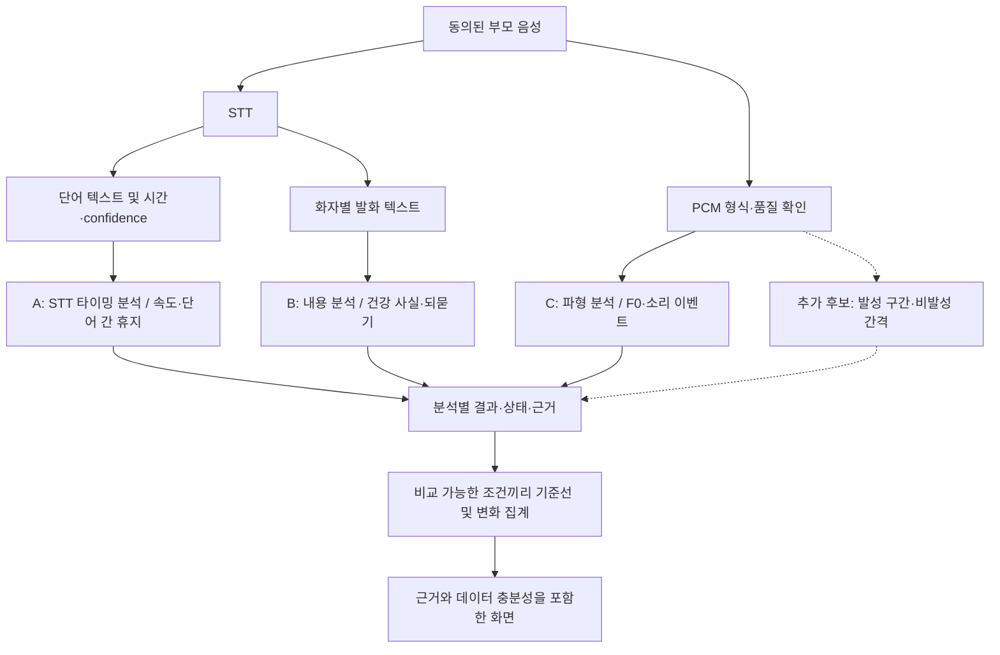

# 분석 파이프라인 분리 점검: 문제 지점과 미활용 정보

대상: `feat/data-analysis`, 기반 커밋 `d6f516e`. 실제 운영 음성이나 DB를 조회하지 않고 현재 코드와 합성 입력을 점검했다. 계산식은 [피처 추출 문서](feature-extraction-current.md), 전체 입출력은 [진입점 문서](data-analysis-entrypoints.md)를 참고한다.

표의 **확인**은 코드에서 직접 확인한 동작, **재현**은 합성 입력으로 해당 함수를 실행한 결과, **가설**은 실제 녹음으로 추가 검증할 영향이다. 개선안은 아직 구현되지 않았다.

테스트 데이터의 생성 방법·Suno 활용 범위·평가 계획은 [테스트 데이터 계획](analysis-test-data-plan.md)에 정리했다.

## 1. 먼저 분리해야 하는 세 가지 분석



이 그림은 제안하는 책임 분리다. 현재 구현은 STT와 공통 발화 길이 게이트 뒤에서 내용 추출 → 음향 분석 → 같은 DB 저장 순으로 실행한다. 점선의 VAD 기반 피처는 아직 없다. 분석기를 나눠도 공통 동의 검증과 원본 폐기 정책은 유지해야 한다.

핵심 구분:

- **STT 타이밍 휴지:** 인식된 단어 사이의 시간. 실제 무음이라고 보장하지 않는다.
- **파형 비발성 구간:** VAD 등으로 분류할 별도 신호. 숨·잡음·기침이 섞일 수 있어 곧바로 무음 또는 망설임으로 해석하지 않는다.
- **턴 간 응답 간격:** 상대 발화 종료와 본인 발화 시작 사이 시간. 두 녹음의 시간축 정렬이 선행돼야 한다.

## 2. 입력·시간축 파이프라인

근거: [VoipCallCenter.swift](../../ios/Collog/VoipCallCenter.swift) `attachAnalysisWriter`, `finishAnalysisRecording`; [models.py](../app/models.py) `AudioAsset`; [webhooks.py](../app/routes/webhooks.py); [pipeline.py](../app/services/pipeline.py) `_process`.

| 확인한 동작 | 문제가 될 지점 | 이용 가능한데 안 쓰는 정보 / 다음 확인 |
|---|---|---|
| 기기 raw는 마이크 publish 이후 writer 부착, Egress는 서버의 track 녹음 시작 경로 | **가설:** 파일 시작점 차이가 존재할 수 있음 | asset별 실제 녹음 시작·종료 및 공통 시각 기준 offset 저장 필요. 현재 created_at/uploaded_at은 음성 sample 0의 정확한 시각이 아님 |
| 각 파일 STT의 상대 startMs를 offset 보정 없이 합쳐 정렬 | **확인:** 응답 지연·질문/답변 시간 인접성을 보장하는 정렬 코드가 없음 | 양 트랙에 같은 기준 소리를 넣는 개발 fixture로 정렬 오차 측정. raw와 Egress도 별도로 확인 |
| iOS가 peak/RMS/p75/p90 및 frame 수를 계산해 로그에 기록 | **확인:** 업로드에는 duration/sampleRate를 보내며 이 품질 요약은 저장하지 않음 | 기기 측 품질과 서버 품질을 비교할 수 있는 최소 통계 추가. percentile 계산법·정규화가 완전히 같지는 않아 숫자의 완전 일치를 기대하면 안 됨 |
| raw 업로드 실패 후에도 로컬 원본 삭제 | **확인:** 같은 파일의 지속적인 업로드 재시도 경로가 없음 | 업로드 실패 빈도부터 집계. 재시도를 추가한다면 한정된 보관 시간과 중복 완료 처리가 필요 |
| 기본 경로에서 부모 Egress를 요구하며 raw-only는 별도 설정 | **확인:** raw가 있어도 Egress 실패로 분석하지 못하는 구성이 가능 | 제품에서 raw-only를 허용할지 정책 결정. 자동 변경보다는 입력별 성공·실패를 관측하는 것이 먼저 |

**선행 조건:** 시간축 정렬을 확인하기 전에는 Egress의 STT 시간을 그대로 raw에 적용해 자르거나, 양 화자의 timestamp 차이를 응답 지연으로 표시하지 않는다.

## 3. STT 및 공통 실행 게이트

근거: [deepgram.py](../app/services/deepgram.py) `_parse`; [pipeline.py](../app/services/pipeline.py) `_process`, `process`.

| 확인한 동작 | 문제가 될 지점 | 개선 또는 미활용 정보 |
|---|---|---|
| 부모 speech_seconds는 인식된 단어 길이 합, 단어가 없으면 segment 길이 합 | **확인:** 동일한 필드의 의미가 입력 형태에 따라 바뀜 | `speech_duration_method`, 유효 word 수, confidence 분포, segment fallback 여부를 보존 |
| confidence가 낮은 단어도 speech_seconds에는 포함됨 | **확인:** 공통 20초 조건과 속도 계산의 유효 단어 집합이 다름 | raw STT 발화 길이와 필터 후 유효 길이를 따로 기록 |
| 20초 미만이면 내용 추출·파형 분석 모두 제외 | **확인:** 짧지만 구체적인 건강 발언과 충분한 raw 파일도 함께 제외 가능 | 내용 추출은 근거 충분성, 속도는 timing 충분성, F0는 유성 구간 길이처럼 분석별 게이트로 나눌지 검토 |
| 파이프라인은 round 후, 분석기는 반올림 전 20초 비교 | **재현:** 19.6초가 파이프라인 기준은 통과하고 분석기 기준은 실패 | 하나의 판정 정책으로 통일하고 표시할 때만 반올림 |
| STT provider 오류가 공통 파이프라인 실패/재시도로 전달됨 | **확인:** 별도로 계산 가능한 파형 분석도 독립 완료할 수 없음 | 동의와 입력 품질을 유지하면서 분석별 terminal 상태와 재시도 단위를 분리 |

STT가 부정확할 때 얼마나 자주 gate를 잘못 통과/탈락하는지는 아직 측정하지 않았다. 낮은 confidence 자체를 질환·발음 이상으로 해석하면 안 된다.

## 4. A: STT 타이밍 분석 — 속도와 휴지

근거: [acoustics.py](../app/services/acoustics.py) `valid_words`, `_speech_rate`, `_pause_ratio`.

| 현재 동작 | 확인한 한계 | 추가 활용 방향 |
|---|---|---|
| 발화 내부 300~2000ms gap만 휴지 분자에 포함 | **재현:** 3초 gap이 있는 한 segment가 휴지 0%, OK를 반환 | 기존 피처 의미를 유지하면서 긴 gap 수/길이 분포를 별도 피처로 검토 |
| segment 사이 gap은 제외 | **재현:** 각각 단어 하나인 두 segment는 사이에 3초가 있어도 INSUFFICIENT_WORD_TIMING | 발화 간 gap을 별도 집계. 상대가 말하던 시간과 구분해야 함 |
| confidence < 0.5 단어를 제거한 뒤 인접 단어 gap 계산 | **재현:** 중간의 실제 발음 단어를 제거하면 그 발음 시간을 휴지에 포함할 수 있음 | 삭제 단어 구간과 겹치는 gap은 불확실로 표시하거나 별도 집계 |
| 속도 분자는 한글 글자만, 분모는 모든 유효 단어 길이 | **확인:** 영어·숫자 중심 발화는 분모만 늘 수 있음 | 한글 포함 비율과 제외 텍스트 비중을 품질 정보로 보존 |
| word 구간 중복·겹침을 합치지 않음 | **가설:** 비정상 timing이면 길이 이중 계산 가능 | 겹침 비율·역순·범위 밖 timestamp 검사 |
| 통화당 한 개 값으로 축약 | **확인:** segment별 편차를 후단에서 알기 어려움 | word 정보가 저장돼 있으므로 발화별 속도·gap 분포를 오디오 없이 재계산 가능 |

### 합성 사례의 구체적 의미

```text
단어 A: 0~1초
단어 B: 4~5초
→ gap 3초는 최대 2초 조건 밖
→ 현재 PAUSE_RATIO = 0 / 5초 = 0%, OK
```

이 결과는 계산 코드의 정의대로지만, UI에서 “침묵이 없었다”로 읽히면 잘못된 설명이다.

```text
단어 A: 0~1초, confidence 1.0
단어 B: 1.1~1.9초, confidence 0.1
단어 C: 2~3초, confidence 1.0
→ B 제거 후 A와 C 사이 1초를 휴지로 계산
→ 현재 PAUSE_RATIO = 1 / 3초 = 33.3333%
```

이때 필터링 전 word gap은 각각 0.1초다. 해결책은 confidence 필터를 무조건 제거하는 것이 아니라, **모르는 구간을 무음으로 간주하지 않는 것**이다.

## 5. C: 파형 분석 — 품질·F0·기침

근거: [acoustics.py](../app/services/acoustics.py) `waveform_quality_reason`, `_waveform_metrics`, `_f0_variation`, `HearCoughDetector`.

| 현재 동작 | 문제 가능성 / 확인 | 미활용 정보와 개선 방향 |
|---|---|---|
| 전체 파일의 품질 한 번 판정 | **확인:** 부분적으로 좋은 구간도 전체 gate 실패 시 제외 | 구간별 clipping·RMS와 유효 구간 비율. 일부 구간 활용 시 피처별 최소 유효 길이를 정의 |
| F0는 전체 파형에 pYIN 적용 | **가설:** 배경 음성·유성 잡음이 통과할 가능성 | 이미 계산하는 voiced/probability와 유효 프레임 비율 보존. 발화 구간 제한은 시간축 정렬 후 검토 |
| F0 필터 후 남은 값끼리 jump 판정 | **확인:** 멀리 떨어진 유성 구간도 인접 값으로 비교 | 원래 frame index를 보존해 연속 구간 내 jump와 구간 사이 변화를 분리 |
| 기침 계산 뒤 F0 계산, 예외 격리 없음 | **재현:** 기침 detector에 RuntimeError를 주입하면 F0 함수에 도달하지 않음 | 기침·F0를 각각 결과 또는 실패 상태로 반환. 특정 피처 장애가 다른 성공 결과를 막지 않도록 분리 |
| 검증 플래그 false여도 계산 후 기침 결과를 덮어씀 | **확인:** 사용하지 않을 추론이 실행되고 원래 사유가 사라질 수 있음 | 사용자 표시 가능 여부와 내부 측정 상태를 분리. 비활성 경로의 추론을 생략할지 정책화 |
| HeAR가 8 class score를 계산하지만 Cough만 사용 | **확인:** Throat Clear/Laugh/Speech 등 구분 정보는 버림 | 개발용 후보 요약과 혼동 사례 검토에 사용. 다른 class도 정확한 탐지로 검증된 것은 아님 |
| F0 배열·기침 window score·품질 통계 미저장 | **확인:** 최종 scalar만으로 원인 분석 어려움 | 원본을 보존하지 않고도 남길 수 있는 최소 진단 요약 정의. 새 데이터 보존 범위는 별도 관리 |
| 기침은 병합 구간 수만 저장 | **확인:** 녹음 길이가 다른 통화를 그대로 count 비교 | 검증 후 분석 가능 시간과 구간 지속시간도 함께 제공할지 검토. 지금 바로 건강 지표로 활성화하지 않음 |

새 후보는 **비발성 간격 분포, 발성 구간 비율, 유효 pitch 비율, 분석 가능 시간**이다. 먼저 분석 품질과 피처 해석에 사용하고, 임상 의미가 있는 사용자 지표라고 전제하지 않는다.

## 6. B: 내용 분석 — 의미와 근거

근거: [gemini.py](../app/services/gemini.py) `normalize_transcript_input`, `validate_facts`; [schemas.py](../app/schemas.py) `ExtractionFact`; [questions.py](../app/services/questions.py); [reports.py](../app/services/reports.py).

| 현재 동작 | 문제 가능성 / 확인 | 미활용 정보와 개선 방향 |
|---|---|---|
| Gemini에는 segment 텍스트·화자·시간을 보내고 word confidence는 전달 안 함 | **확인:** 내용 추출 단계가 전사 불확실성을 직접 구분하지 못함 | evidence 구간별 저신뢰 단어 비중을 검토 상태에 반영. 모델 confidence 점수와 혼동하지 않기 |
| 근거 부모 발화에 범주 키워드가 있어야 함 | **확인:** “두 번”처럼 질문 맥락에만 주제가 있는 답은 걸러질 수 있음 | 질문과 답변을 함께 근거로 하는 schema. 시간축 확인과 모호한 응답 보류가 선행 |
| fact는 범주당 한 개, 최대 네 개 | **확인:** 같은 범주의 서로 다른 사건을 구조적으로 분리하기 어려움 | 주제·시점·대상자별 사건 배열. 말하지 않은 시간·빈도는 null 유지 |
| polarity와 evidence ID를 저장 | **확인:** 리포트 conversationItems는 요약 문자열만 모음 | 저장된 근거를 활용한 클릭 가능한 카드, 언급 없음/부정/불확실 구분 |
| 질문 pool에 식사 질문과 예/아니오형 질문 존재 | **확인:** 추출 범주에는 식사가 없고 짧은 답은 grounding에서 빠질 수 있음 | 질문마다 답이 저장될 목적지와 근거 조건을 정해 계약 검사 |
| 질문 선택은 조건·제외 ID·날짜 seed 기반 | **확인:** 함수가 이전 건강 facts나 미해결 관찰을 입력받지 않음 | 이미 저장된 facts로 다음 확인 질문 선택. 제안된 질문과 실제로 물은 질문은 구분 |

내용 추출의 발전과 음향 피처 개선은 서로 다른 검증 세트를 사용해야 한다. 키워드 누락을 고쳐도 파형 휴지의 정확도가 좋아지는 것은 아니다.

## 7. 저장·실패 전파·종단 비교

근거: [pipeline.py](../app/services/pipeline.py), [signals.py](../app/services/signals.py), [reports.py](../app/services/reports.py), [models.py](../app/models.py).

| 확인한 동작 | 영향 | 우선 조치 |
|---|---|---|
| Gemini 결과를 메모리에 받은 뒤 음향 분석, 그 뒤 같은 transaction에서 추출·음향·신호 저장 | 음향 또는 신호 계산 예외가 나면 성공한 추출 결과도 저장되지 않을 수 있음. 전사·되묻기는 앞서 별도 commit됨 | 분석별 결과 checkpoint와 재실행 계약 정의 |
| 상태는 통화 ANALYZED지만 extraction은 FAILED일 수 있음 | 통화 성공률이 내용 추출 성공률을 나타내지 않음 | STT/내용/타이밍/F0/기침/집계별 상태와 실패 원인 |
| cough_detector_version을 heuristic 문자열로 고정 기록 | 실제 기본 HeAR와 기록 불일치 | 실제 설정/모델 checksum·분석 버전 기록 |
| 기준선이 analyzer version과 단위를 필터링하지 않음 | 버전·단위가 다른 관측이 섞일 수 있음 | metric 의미·단위·버전별 호환 키로 비교 집합 제한 |
| 주별 표본 수인데 remainingCalls라는 API 이름 | 통화를 더 하면 바로 채워지는 것으로 오해 가능 | 주별 충족 상태와 실제 필요한 기간을 표시 |
| 음향 추이는 OK 행만, 날짜/값만 표시 | 실패가 몰린 시점이 보이지 않고 하루 여러 통화를 식별하기 어려움 | 대상 통화 수, 분석 가능 수, 제외 수와 정확한 시각·call ID 유지 |
| 기준선 날짜와 리포트 기간의 timezone 처리가 다름 | 주 경계 부근 비교가 다를 수 있음 | 공통 달력 경계 정책 및 한국 자정 fixture |
| 과거 리포트 스냅샷 재사용 | 코드 수정 후에도 과거 결과가 달라지지 않을 수 있음 | 계산 버전과 재발행 정책, 과거 기록 변경 이력 |

기존 성공/제외/실패 통화는 단순 process 재호출로 모두 재처리되는 구조가 아니다. 원본 폐기 후 재계산 가능한 것은 보존된 단어/텍스트/최종 피처 범위로 제한된다.

## 8. 권장 작업 순서와 합격 기준

| 순서 | 범위 | 검증 기준 |
|---|---|---|
| 1 | 상태·실패 격리, 실제 버전 기록 | 기침 오류를 주입해도 타이밍·F0·성공한 추출 결과가 각자 보존됨. 비활성 기침 정책이 명확함 |
| 2 | timing과 품질 진단 CSV | 긴 gap, confidence 제거, segment 경계 fixture가 각각 구분되며 null을 0으로 바꾸지 않음 |
| 3 | 녹음 시간축 확인 | 트랙별 공통 시각에 대한 offset과 측정 오차를 기록. 응답 지연 피처에 허용할 오차를 먼저 정함 |
| 4 | 파형 기반 분할 실험 | 사람이 표시한 발성/비발성/기침/잡음 구간과 비교. STT 휴지와 다른 정의로 결과를 저장 |
| 5 | 질문–답변 및 사건 추출 | 질문 맥락의 짧은 답, 다른 사람 이야기, 정정, 무응답 fixture를 개별 평가 |
| 6 | 개인 비교와 화면 | 버전·단위 혼합 방지, 실패/제외 분모 표시, 같은 기간·시간대 fixture 일치 |

우선순위는 새 모델 추가보다 **분석별 실패를 구분하고 현재 출력의 의미를 정확히 관찰하는 것**에 둔다.

### 개발용 CSV 제안

```text
analysis_runs.csv
call_id,stage,status,reason,algorithm_version,input_asset_kind,valid_duration_sec

word_timing.csv
call_id,speaker,segment_id,word_index,start_ms,end_ms,confidence,accepted_by_filter

pause_candidates.csv
call_id,segment_id,gap_start_ms,gap_end_ms,gap_ms,within_segment,
low_confidence_overlap_ms,included_in_current_pause

waveform_quality.csv
call_id,duration_sec,sample_rate,clipping_ratio,active_dbfs,voiced_ratio,quality_reason
```

이 표들은 제안이며 export는 아직 구현하지 않았다. word timing은 기존 전사에서 대부분 재구성할 수 있다. waveform 중간 통계는 현 계산 과정에서 저장하도록 추가해야 한다. text는 의미 분석 검토에 필요한 별도 export에만 포함하고 timing 검사에는 ID로 연결해도 된다.

## 9. 이번 검증 범위

- 코드 조사: 입력·업로드, STT 파싱, 타이밍/파형, 내용 추출, 저장 transaction, 기준선 및 리포트.
- 합성 함수 검증: 3초 gap, 낮은 confidence 단어 제거, segment 사이 gap, 기침 사유 덮어쓰기, detector 예외의 F0 전파, 19.6초 길이 경계.
- 실행 코드를 변경하지 않았고 DB 연결, 서버 기동, 실제 provider 호출, 원본 녹음 보관 정책 변경을 하지 않았다.
- ONNX·pYIN의 실음성 정확도, 실제 기기 시간축 오차, 실제 데이터의 실패율은 미검증이다. 이 문서는 해당 성능을 주장하지 않는다.
